# Enterprise Revenue Integrity Platform

**A sales commitment is not an invoice. An invoice is not collected cash. A timeout is not proof that a financial action failed.**

An executable order-to-cash control layer and operator application. It follows a commercial commitment through billing and finance, explains the differences at source grain, and requires separate review before a bounded recovery action. PostgreSQL stores identity, immutable intent, independent receipt proofs and decisions; six dbt models reconcile financial facts against an independently written source-ledger oracle.

All Northstar business records are synthetic USD. Three separately running HTTP contract services represent finite Salesforce, Stripe Billing and NetSuite behaviors. **No native business-vendor API or paid cloud resource is used.**

## Docker Quick Start

With Docker Engine 28+ and Compose V2 using Linux containers:

```text
docker compose up --build
```

Wait for `ready`, then open **http://127.0.0.1:8582**. In another terminal, retrieve your generated private login:

```text
docker compose exec demo python -m integrity.portable credentials --user auditor
```

Use `operator` to propose and `approver` to decide. Startup runs the actual PostgreSQL/HTTP/financial scenario. Only the console is published on host loopback. Stop and remove the disposable state with `docker compose down --volumes --remove-orphans`. [Five-minute walkthrough, port selection and security boundary](docs/portable-demo.md).

[Executed Docker acceptance, recovery evidence and fresh screenshots](docs/evidence/portable/README.md).


## Follow the difference

The initial transaction produces $42,000 in quarterly invoices and matching ERP invoice postings, with $16,500 in allocated cash. Source-owned credits, proration and contract changes then produce the current lifecycle comparison:

| Q1 2026 measure | Synthetic USD |
|---|---:|
| Expected issued-invoice basis | $39,000 |
| Billing net invoices | $39,000 |
| ERP invoice postings | $37,500 |
| Allocated cash, a separate flow | $16,500 |
| Period-end active ARR, a separate stock | $120,000 |

The **$1,500 unposted adjustment remains open**. A passing quality gate faithfully represents that unresolved difference; it does not declare the books balanced or establish recognized revenue.

In the working console, a fourth synthetic account has an exhausted delivery after three actual rejected HTTP attempts. An operator proposes an exact retry, a separate approver rejects or approves it, and the worker rechecks source authority and identity. Successful recovery activates its $6,600 quarterly invoice; a durable financial recheck yields **$45,600 billing / $44,100 ERP**, cash still $16,500 and ARR $146,400. The original $1,500 issue remains unresolved. These are calculated local source outcomes, not commercial results.

[Inspect execution evidence](docs/evidence/README.md) · [Try the operator workflow](docs/operator-console.md) · [Financial definitions](docs/financial-contract.md)

## Adversarial security and recovery acceptance

A separate **25-case PostgreSQL/HTTP acceptance suite** challenges populated tenant isolation, native row security, real session/CSRF/origin boundaries, competing approvals, four worker termination points, database/service restarts and reviewed restoration against surviving receiver history. The existing **65-test baseline** and fresh **47-check browser acceptance** also passed.

The probes reproduced and corrected two recovery defects: index hashes alone could miss corrupted receipts/records, and conflicting restored history could be partially imported before rejection. Financial calculations and fixtures remain unchanged; the synthetic **,500 ERP discrepancy stays open**. Failed observations, exact source revisions and independent source arithmetic are retained.

[Executed findings, screenshots and limitations](docs/evidence/adversarial/README.md) · [Reproduction and security boundaries](docs/adversarial-acceptance.md). These are local and container test-environment controls, not native business-vendor or production acceptance.

## Architecture and controls

```mermaid
flowchart LR
  CRM[Commercial authority] --> I[Verified source and canonical identity]
  I --> O[(PostgreSQL inbox and outbox)]
  O --> W[Bounded fenced worker]
  W --> B[Independent billing HTTP service]
  B --> R[Receipt and record readback]
  R --> N[Independent finance HTTP service]
  N --> V[Verified receipt and audit]
  V --> D[Source snapshots and six dbt models]
  D --> P[Independent oracle and gated publication]
  P --> UI[Scoped operator console]
  UI --> A[Exact proposal and separate approval]
  A --> W
```



- Explicit tenant/legal-entity customer mappings and current source ownership checks; ambiguous identity blocks activation.
- Expansion, contraction, cancellation, renewal and linked backdated corrections preserve original events and business/observation times.
- Independent receipt and per-record GETs establish history before retry. A historical receipt never authorizes a new downstream action.
- Durable attempt budgets, session locks, fencing, exhausted states and two-person exact-content retry grants. An actual killed-process test covers restart recovery.
- Separate database identities, native PostgreSQL row security, scoped browser access, hashed sessions, CSRF checks and append-only decisions/audit.
- Restored control state fails closed against independent receiver inventories. Reviewed journal recovery rehydrates only verified history, with zero remote action POSTs.
- Invoice-grain reconciliation, nine variance categories, independent full-build equality, actual local PostgreSQL analytical-query parity and integrity-checked JSON publication.

[Architecture](docs/architecture.md) · [Security](docs/security.md) · [Recovery](docs/recovery.md) · [Verification and limitations](docs/internal-review.md)

## Run locally

Use Python 3.12 and PostgreSQL 17. No vendor credentials are required.

```text
python -m venv .venv
# Activate .venv using your operating system's activation command.
python -m pip install pip==26.2.2
python -m pip install -r requirements.lock
python -m pip install --no-deps -e .
# Set PG_BIN to the directory containing PostgreSQL 17 initdb and pg_ctl.
python -m integrity.console --workspace .local/console-01 --port 8582
```

Open `http://127.0.0.1:8582`. Generated operator credentials are saved privately in `.local/console-01/operator-credentials.json`; they are never embedded in the public UI. Use `auditor` to inspect, `operator` to propose, and `approver` to decide. Startup executes the actual financial scenario before opening the application.

```text
python scripts/verify.py --workspace .local/verify-01 --output .local/evidence-01
python scripts/check_evidence.py
```

[OS-specific setup, scenarios and browser tests](docs/reproduction.md). Each run requires fresh paths and cleans only its own processes/databases. Never supply a production administrator connection.

## Evidence boundaries

The preserved [foundation](docs/evidence/pass1/README.md), [financial slice](docs/evidence/pass2/README.md), [completed lifecycle](docs/evidence/pass2-complete/README.md), [internal acceptance](docs/evidence/internal-acceptance/README.md) and [genuine browser captures](docs/evidence/operator-console/README.md) are separate recorded executions with exact source revisions. Earlier artifacts retain their original bytes.

Delivery is at least once with idempotent effects under the demonstrated receiver contracts. Shared local PostgreSQL infrastructure, loopback HTTP and finite synthetic cases do not establish production isolation, HA, RPO/RTO, throughput, universal exactly-once delivery, or atomic external authorization. Snowflake SQL is syntax-only; actual warehouse execution is DuckDB and local PostgreSQL. No arbitrary daily proration, FX, tax, refunds or GAAP/IFRS recognition engine is claimed.

[Progress ledger](docs/progress.md). The separate independent architecture/security audit remains pending. This application is not publicly deployed. Portable execution is submitted as a separate draft PR for review.
