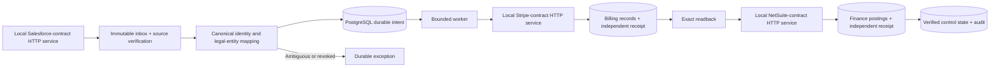

# Enterprise Revenue Integrity Platform

**A sales commitment is not an invoice. An invoice is not collected cash. A timeout is not proof that a financial action failed.**

This order-to-cash integration resolves a commercial commitment to the correct customer and legal entity, creates billing records, posts an ERP invoice and partial payment application, and confirms each effect against independent receiver records. PostgreSQL holds canonical identity, source provenance, immutable intent, attempts, exceptions and the audit trail.

The executable foundation uses three separately running HTTP contract services and four separately owned PostgreSQL databases. All business records are synthetic. These services represent a limited Salesforce, Stripe Billing and NetSuite contract; **no native vendor API is called**.

## Trace a transaction

The two-entity Northstar fixture produces **USD $42,000 in quarterly invoices**, **$42,000 in ERP invoice postings** and **$16,500 in allocated cash**. These values are calculated from executed source records, not interchangeable revenue measures. The ERP invoice credits deferred revenue; this project does not implement recognized revenue or claim accounting compliance.

1. A Salesforce-contract Opportunity becomes Closed Won and references a matching executed commitment.
2. Explicit, approved mappings resolve Account → canonical customer → billing and ERP customer within the same tenant/legal entity.
3. Billing creates a subscription, item, invoice and invoice line. Independently seeded settlement records support partial payment allocations.
4. Finance posts the invoice and applications, retaining the original billing references.
5. The controller verifies the receiver receipt **and independently reads every business record** before confirming its own state.

The demo also commits a billing effect, deliberately delays the response beyond the controller timeout, and recovers through readback without a second effect. An ambiguous third account blocks before dispatch.

[Executed evidence](docs/evidence/pass1/README.md) · [Architecture and authority](docs/architecture.md) · [Recovery and limits](docs/recovery.md) · [Reproduction](docs/reproduction.md) · [Verified progress](docs/progress.md)

**Financial reconciliation:** the [implemented analytical slice](docs/financial-contract.md) compares a scheduled invoice basis, billing net invoice and ERP invoice postings. Contract-backed lifecycle changes, source corrections and six dbt models retain a $1,500 unposted adjustment as **review required**. The current lifecycle quarter shows $39,000 billing, $37,500 ERP invoice postings, $16,500 allocated cash and $120,000 ARR separately. [Executed lifecycle, incremental and portability proof](docs/evidence/pass2-complete/README.md). Operator security/console work and the independent audit are tracked separately.



## Run locally

Use Python 3.12 and PostgreSQL 17. No vendor credentials are required.

```text
python -m venv .venv
# Activate .venv using your operating system's activation command.
python -m pip install pip==26.2.2
python -m pip install -r requirements.lock
python -m pip install --no-deps -e .
# Set PG_BIN to the directory containing PostgreSQL 17 initdb and pg_ctl.
python -m integrity.demo --workspace .local/demo-01 --output .local/demo-01.json
python scripts/verify.py --workspace .local/verify-01 --output .local/evidence-01
```

Each command requires fresh workspace/evidence paths and stops only its own service processes and cluster. Existing private workspaces are retained. Alternatively use an explicitly isolated PostgreSQL test server through `INTEGRITY_ADMIN_DSN`; the harness creates random databases/roles and removes only those at exit. **Never point that administrator setting at a production server.** See [OS-specific setup and local-only credentials](docs/reproduction.md).

## Controls with executed tests

- Exact event identity and source-content verification; extra financial fields and stale source state cannot acquire CRM authority.
- Explicit tenant/legal-entity mappings; missing, ambiguous and cross-entity resolution blocks.
- Durable stable effect IDs before dispatch; mismatched idempotency content is rejected.
- Independent receipt and record reads precede retries. Historical receipt reconciliation does not grant authorization for a new ERP intent.
- Three dispatch attempts, persisted exponential backoff and explicit exhaustion. Session locks serialize competing workers; an actual killed-process test verifies restart recovery.
- Separate database identities; integration roles cannot edit mappings, rewrite receipts or connect to another service's database.

Delivery is **at least once with idempotent effects under the demonstrated receiver contract**. This is not a universal exactly-once guarantee, distributed atomic authorization, production tenant isolation or a production throughput claim. The shared local PostgreSQL server is not an independent infrastructure failure domain.

The roadmap continues with financial reconciliation, adversarial review and an authenticated operator console. The [progress ledger](docs/progress.md) distinguishes passed gates from unfinished work. A separate independent architecture/security audit remains required. Nothing is deployed or merged automatically.
