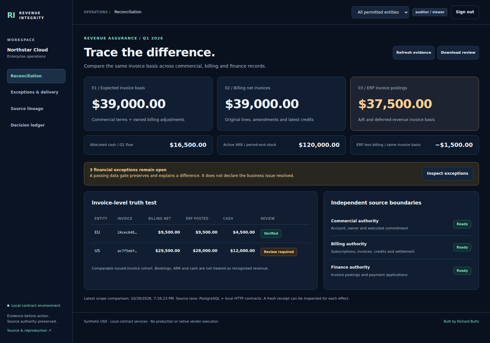

# Portable application acceptance

This package records the **normal Docker image**, not an HTML preview or a substitute business workflow. It executes the original lifecycle, authenticated operator console, independent HTTP services, PostgreSQL RLS and financial publication contracts with synthetic USD sources.

## Inspect the records

| Record | What it establishes |
|---|---|
| [Packaged execution](compose-run02/portable.json) | Exact source revision/hashes, actual Engine version, container controls, shutdown, old-credential/session rejection, fresh-fixture parity and independent teardown inventory |
| [Initial restricted SQL/receiver observations](compose-run02/initial.json) | Three-attempt exhausted delivery, native row security, separate role privileges, scoped results and independent receipt stores |
| [After approved recovery](compose-run02/recovered.json) | Rejected and approved decisions, verified billing/finance effects, exact payload/record readback and persisted financial recheck |
| [Fresh restart](compose-run02/restarted.json) | New run, original financial fixture and original receiver-effect inventory; prior review actions do not carry over |
| [Financial lifecycle](compose-run02/lifecycle.json) | Actual dbt/DuckDB builds, source-ledger oracle, six-model full-build equivalence and six real local PostgreSQL analytical comparisons |
| [Browser acceptance](compose-run02/browser/browser.json) | Actual browser version, executed observations, accessibility scans, original source fingerprints and screenshot hashes |
| [Artifact integrity](compose-run02/artifact-integrity.json) | Complete inventory and SHA-256 hashes of the published files |

The current successful record pins implementation **`e8f6493c9f9001867a00b1dc34bad1c5e9a687d0`**. [Actual Docker workflow](https://github.com/rlbsem/enterprise-revenue-integrity-platform/actions/runs/40384848067) executes two independent fresh-state cycles, each including shutdown and restart. The complete first cycle is archived here. The [earlier 43-check packaged record](compose-run01/portable.json) remains unchanged at its original source revision.

## Actual results

- **47 browser checks**, ten accessibility views with zero violations, zero browser script errors and five genuine screenshots. Coverage includes separate operator/approver interaction, rejection without dispatch, exact approval, independently verified effects, financial recheck, export, scope denial, logout and mobile rendering. Added checks force a real DOM refresh while preserving the same proposal note, require clearing on scope change and verify the exact approval POST. Browser proposal IDs are independently matched to SQL decisions, delivery authorization and the verified financial job.
- Actual restricted SQL logins independently establish operator proposal privilege without approval privilege, approver approval privilege without proposal privilege, read-only auditor access and no Northstar rows for the outsider. RLS remains enabled on the recorded control tables; EU scope remains restricted.
- The auditor sees initial **$39,000 billing / $37,500 ERP**, cash $16,500 and ARR $120,000. The approved recovery produces **$45,600 billing / $44,100 ERP**, cash still $16,500 and ARR $146,400. The **$1,500 open difference remains**. The checker independently compares control intent, receiver payloads, canonical receipt hashes and original business-record bodies.
- Original financial processing executes six dbt models and at least fifteen tests per recorded build. All six incremental/full-build model contents agree; the source-ledger oracle and local PostgreSQL typed-value comparisons pass. Snowflake remains syntax-only, not native execution.
- Shutdown and restart pass, including rejection of the old password/session and exact financial-fixture parity. Independent Docker-label inventories show no owned containers, networks or volumes after teardown. Cached source-only images can remain.

The [fresh Windows regression](windows-regression-run01/verification.json) at `be189ac9c3bb372ceb07092b4d771d08e177e87e` passed **65 tests, zero failures/errors/skips**, plus both original standalone demos. The subsequent `e8f6493` change binds browser automation and proof to actual proposal IDs; it does not change financial calculations. [GitHub regression at the current proof revision](https://github.com/rlbsem/enterprise-revenue-integrity-platform/actions/runs/40384848053) also passed. Native Windows portable acceptance at the current proof revision passed the 47 browser observations, actual PostgreSQL/HTTP recovery, shutdown and fresh restart. That fallback establishes no Docker isolation. An earlier local verification invalidated its completion record when source changed during execution and is not counted as a completed acceptance run.

## Preserved failed attempts

The [first container attempt](failed-build-run01/portable.json) failed during image installation, before application startup; its [original hashes](failed-build-run01/artifact-integrity.json) and successful empty teardown inventory remain preserved. [Failed workflow](https://github.com/rlbsem/enterprise-revenue-integrity-platform/actions/runs/40374878182).

The [diagnostic build](https://github.com/rlbsem/enterprise-revenue-integrity-platform/actions/runs/40375341150) identified `Cannot import 'setuptools.build_meta'`: the initial image disabled build isolation without installing the declared backend. The corrected image uses the exact pinned build requirements from `pyproject.toml`. Neither failed attempt is represented as successful application execution.

The [earlier stalled approval run](failed-approval-run01/portable.json) and [scoped diagnostic run](failed-diagnostic-run01/portable.json) remain failures. The latter shows a pending second proposal, exhausted delivery and no financial job; it does not establish a worker or financial success.

The decisive [targeting diagnostic](failed-targeting-run01/draft-observation.json), with its [failed run](failed-targeting-run01/portable.json) and unchanged hashes, shows the new note attached to the previously rejected proposal while the new pending card was still loading. The backend correctly refused to dispatch. The browser test now captures actual proposal IDs from POST responses, waits for the exact card and matches the exact approval response. In-memory UI drafts are separately keyed by action/proposal and content hash; stale refresh responses are discarded and background refresh cannot interrupt typing. These functional fixes preserve the existing visual design and server authorization contract. [Recorded failed workflow](https://github.com/rlbsem/enterprise-revenue-integrity-platform/actions/runs/40383684832).

## Genuine normal-image screenshots



[Exact approval](compose-run02/browser/console-approval.png) · [Independent lineage](compose-run02/browser/console-lineage.png) · [Recovered comparison](compose-run02/browser/console-recovered.png) · [EU-scoped mobile view](compose-run02/browser/console-mobile.png)

Images are unedited captures from the existing Playwright browser script against the actual host-published application. The mobile image intentionally shows only EU-authorized figures. The source-pinned browser script defines roles/viewports, and its record supplies actual browser version and exact image hashes.

## Recheck and reproduce

```text
python scripts/check_portable_evidence.py docs/evidence/portable/compose-run02
python scripts/check_portable_evidence.py docs/evidence/portable/failed-build-run01 --failed
python scripts/check_portable_evidence.py docs/evidence/portable/failed-targeting-run01 --failed
python scripts/verify_portable.py --workspace .local/portable-review --output .local/portable-review-evidence
```

[Launch and security boundary](../../portable-demo.md). This remains a trusted-host, local HTTP demonstration using separate databases on one PostgreSQL cluster. No egress firewall, production SSO/TLS, native business-vendor execution, public deployment or commercial revenue outcome is established. Historical evidence and original financial/recovery behavior are unchanged; cosmetic PR #2 is separate.
